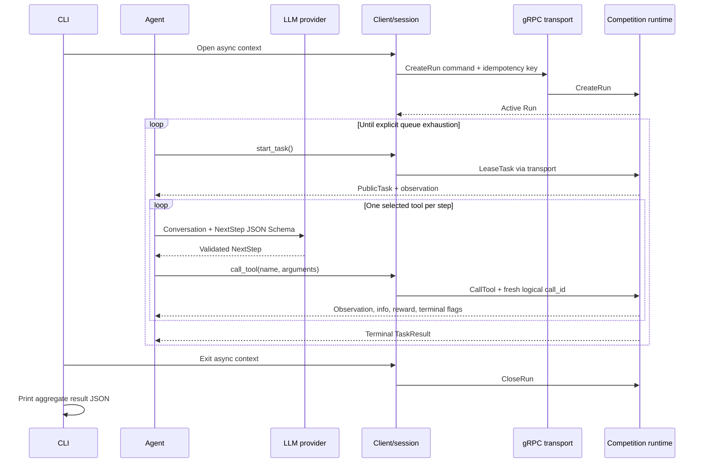
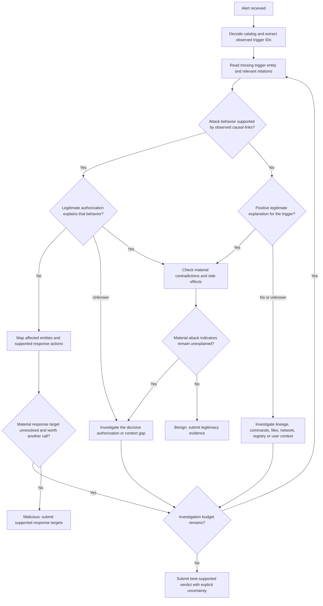

# BlueSec1 reference agent: repository analysis

This report covers the README, agent, client, remote transport, mappers, models, source proto, generated bindings, tests, configuration example, packaging configuration, and generation script. No files were modified.

**Central finding:** this repository implements a participant agent and runtime client. It does **not** include the competition’s scenario graphs, graph schema, tool implementations, ground truth, or scoring algorithm. The transport contract is explicit; much of the investigation contract arrives dynamically from the server.

“Documented” below means supported directly by repository contents. “Proposed” identifies strategy or implementation recommendations, rather than competition rules.

## 1. Competition goal and scoring

### Goal

The agent receives a security alert, explores an evidence graph, and submits a classification:

- `malicious`: a real attack.
- `benign`: a false positive.

The README states that the task is to determine whether an alert represents an attack and report either entities requiring a response or graph evidence establishing legitimacy. It identifies processes, files, network connections, registry writes, and their relationships as graph contents. See [README.md:3](/home/cbr4l0k/Documents/projects/falsePositive/bluesec1-agent/README.md:3) and [README.md:48](/home/cbr4l0k/Documents/projects/falsePositive/bluesec1-agent/README.md:48).

The exact verdict strings come from `FinishInvestigationRequest`, not a protobuf verdict enum. See [agent/models.py:60](/home/cbr4l0k/Documents/projects/falsePositive/bluesec1-agent/src/bluesec1_agent/models.py:60).

### What scoring documentation actually says

The complete qualitative scoring statement is:

> “Scoring rewards a correct verdict and the artifacts you found, and penalises wasted tool calls.”

The following sentence says that thorough investigation with fewer calls beats brute force. See [README.md:61](/home/cbr4l0k/Documents/projects/falsePositive/bluesec1-agent/README.md:61).

This establishes three objectives:

| Objective | Repository evidence | Unspecified details |
|---|---|---|
| Correct classification | README explicitly rewards a correct verdict. | Weight; asymmetric costs of false positives versus false negatives; interaction with artifact credit. |
| Artifact discovery/reporting | README rewards artifacts and asks for response entities or legitimacy evidence. | Matching rules; discovery versus submission credit; completeness; penalties for extra or wrong artifacts. |
| Efficient investigation | README penalizes wasted calls. | Cost per call; whether useful calls also have cost; treatment of failed calls, repeats, searches, and transport retries. |

There is no implementation supporting a numeric formula, fixed call penalty, F1 score, maximum reward, or particular weighting.

### Public score outputs

The server returns these terminal `TaskResult` fields:

| Field | Proto type | Meaning supported by the contract |
|---|---|---|
| `task_id` | `string` | Task correlation identifier. |
| `completion_reason` | `CompletionReason` | Terminated, truncated, error, or aborted. |
| `total_reward` | `double` | Server-reported total reward. |
| `steps_taken` | `uint32` | Server-reported step count. |
| `tool_calls` | `uint32` | Server-reported tool-call count. |
| `quality_score` | `double` | Public quality score; formula unspecified. |
| `efficiency_score` | `double` | Public efficiency score; formula unspecified. |
| `wall_time_seconds` | `double` | Elapsed time; whether it affects score is unspecified. |

See [runtime.proto:150](/home/cbr4l0k/Documents/projects/falsePositive/bluesec1-agent/proto/investigation/runtime/v1/runtime.proto:150).

Individual `ToolCallResponse` messages also carry a `reward`. The repository does not establish whether `total_reward` is simply the sum of those rewards. See [runtime.proto:137](/home/cbr4l0k/Documents/projects/falsePositive/bluesec1-agent/proto/investigation/runtime/v1/runtime.proto:137).

The mapper validates score values as finite numbers, but does not require scores to lie in `[0,1]` or calculate them locally. See [transport/mappers.py:533](/home/cbr4l0k/Documents/projects/falsePositive/bluesec1-agent/src/bluesec1_client/remote/transport/mappers.py:533).

Tests deliberately restrict results to public score fields and reject `max_possible_reward`. Their example values are fixtures, not evidence of a scoring formula. See [test_remote_contract.py:86](/home/cbr4l0k/Documents/projects/falsePositive/bluesec1-agent/tests/test_remote_contract.py:86).

**Important distinction:** the agent’s `successful_tasks` counter counts completion reasons `terminated` and `truncated`. It does not measure correct verdicts or high scores. See [agent.py:98](/home/cbr4l0k/Documents/projects/falsePositive/bluesec1-agent/src/bluesec1_agent/agent.py:98).

## 2. End-to-end architecture

### Components and lifecycle



#### Startup

The executable entry point is `bluesec1_agent.cli:main`; `python -m bluesec1_agent` also invokes it. Packaging requires Python 3.11 or newer. See [pyproject.toml:1](/home/cbr4l0k/Documents/projects/falsePositive/bluesec1-agent/pyproject.toml:1) and [agent/__main__.py:1](/home/cbr4l0k/Documents/projects/falsePositive/bluesec1-agent/src/bluesec1_agent/__main__.py:1).

The CLI:

1. Injects system trust-store handling into Python SSL.
2. Loads settings.
3. Creates the LLM wrapper.
4. Opens a `RemoteBenchmarkClient`, supplying endpoint, token, TLS selection, label, agent/model names, arena, and diagnostic metadata.
5. Runs the agent.
6. Closes the contexts.
7. Prints the aggregate result as JSON.

See [cli.py:45](/home/cbr4l0k/Documents/projects/falsePositive/bluesec1-agent/src/bluesec1_agent/cli.py:45).

The runtime bearer credential is attached to every RPC. TLS is enabled by default. **Setting `verify_tls=False` creates an insecure channel**, rather than encrypted TLS with relaxed certificate checks. See [transport/grpc.py:157](/home/cbr4l0k/Documents/projects/falsePositive/bluesec1-agent/src/bluesec1_client/remote/transport/grpc.py:157) and [transport/grpc.py:390](/home/cbr4l0k/Documents/projects/falsePositive/bluesec1-agent/src/bluesec1_client/remote/transport/grpc.py:390).

#### Run lifecycle

`RemoteBenchmarkClient` begins in local state `new`. `open()` creates a new run, verifies its returned state is `active`, and transitions to `open`.

- Calling `open()` again while open returns the existing run.
- A closed client cannot reopen.
- Failure during remote run creation closes the client and its owned transport.
- There is no API for attaching to or resuming an existing run.

See [remote/client.py:123](/home/cbr4l0k/Documents/projects/falsePositive/bluesec1-agent/src/bluesec1_client/remote/client.py:123).

The README says a participant may have only one run in flight. Capacity enforcement is server-side; the proto also distinguishes participant and overall runtime capacity errors. See [README.md:45](/home/cbr4l0k/Documents/projects/falsePositive/bluesec1-agent/README.md:45).

Arena selection is optional. Omitting it lets the runtime choose the open default. See [runtime.proto:88](/home/cbr4l0k/Documents/projects/falsePositive/bluesec1-agent/proto/investigation/runtime/v1/runtime.proto:88).

#### Task lifecycle

`start_task()` sends `LeaseTask` and returns:

- A `RemoteBenchmarkSession` for a leased `PublicTask`.
- `None` only for an explicit `QueueExhausted` outcome.

It validates the owning run ID. A leasing error is not interpreted as queue exhaustion. See [remote/client.py:168](/home/cbr4l0k/Documents/projects/falsePositive/bluesec1-agent/src/bluesec1_client/remote/client.py:168).

The reference agent leases and investigates tasks sequentially. The client serializes lifecycle operations with a lock; each session serializes its own tool and abort operations. The client itself does not maintain an active-session registry or locally enforce a one-task limit.

### Observation shape and tool catalog

The typed task boundary is minimal:

```text
PublicTask:
    task_id: string
    observation: arbitrary string-keyed recursive object
```

There is no typed alert message. See [client/protocols.py:12](/home/cbr4l0k/Documents/projects/falsePositive/bluesec1-agent/src/bluesec1_client/protocols.py:12).

The README makes `observation["available_tools"]` authoritative for enabled tools and exact argument schemas. The implementation expects this field to be a **JSON-encoded string**, decoding to a list of objects. It rejects an already-decoded list. See [README.md:56](/home/cbr4l0k/Documents/projects/falsePositive/bluesec1-agent/README.md:56) and [agent.py:204](/home/cbr4l0k/Documents/projects/falsePositive/bluesec1-agent/src/bluesec1_agent/agent.py:204).

The test fixture demonstrates, without defining a production schema:

```json
{
  "alert_text": {
    "trigger_entities": []
  },
  "available_tools": "[{\"name\":\"get_entity\",\"parameters\":{\"type\":\"object\"}}, ...]"
}
```

See [test_agent.py:50](/home/cbr4l0k/Documents/projects/falsePositive/bluesec1-agent/tests/test_agent.py:50).

The agent extracts string-valued `name` entries and requires `finish_investigation`. It does not fully validate tool-specification structure, unique names, or argument schemas.

The catalog is decoded **once at task start**. Neither the agent nor session updates the initial task observation after tool calls.

### Tool-call and response flow

For each valid LLM step:

1. Extract the selected tool name.
2. Serialize its model fields, excluding the `tool` discriminator.
3. Append a synthetic assistant tool-call message to history.
4. Check tool-name membership in the initial catalog.
5. If available, invoke `session.call_tool(name, arguments)`.
6. Return immediately if the response contains `task_result`; otherwise append feedback and continue.

An unavailable tool is rejected locally and produces error feedback without a runtime RPC. It still consumes an agent loop iteration. See [agent.py:145](/home/cbr4l0k/Documents/projects/falsePositive/bluesec1-agent/src/bluesec1_agent/agent.py:145).

The session:

- Requires an open parent client and nonterminal task.
- Validates canonical argument values.
- Generates a UUID-based `call_id`.
- Sends a transport-neutral command.
- Checks run, task, call, and tool correlation.
- Caches terminal state.

See [remote/session.py:77](/home/cbr4l0k/Documents/projects/falsePositive/bluesec1-agent/src/bluesec1_client/remote/session.py:77).

The mapper encodes commands into protobuf and decodes server responses. Dynamic objects support null, booleans, signed 64-bit integers, finite floats, strings, lists, and string-keyed objects. Default limits are depth 16, 10,000 total collection entries, 1 MiB per UTF-8 string, and 4 MiB per message. See [remote/models.py:54](/home/cbr4l0k/Documents/projects/falsePositive/bluesec1-agent/src/bluesec1_client/remote/models.py:54) and [transport/mappers.py:30](/home/cbr4l0k/Documents/projects/falsePositive/bluesec1-agent/src/bluesec1_client/remote/transport/mappers.py:30).

The LLM receives this reduced feedback:

```text
tool_name
status       = info.tool_status, otherwise "unknown"
result       = info.tool_result, otherwise observation
error        = info.error
reward
terminated
truncated
```

Additional `info` fields are omitted. When `tool_result` exists, the complete observation is not separately included. See [agent.py:230](/home/cbr4l0k/Documents/projects/falsePositive/bluesec1-agent/src/bluesec1_agent/agent.py:230).

### Terminal results and failures

The gRPC mapper requires `task_result` exactly when `terminated` or `truncated` is true.

Valid terminal completion semantics are:

- `terminated=True` with completion reason `terminated`.
- `truncated=True` with completion reason `truncated` or `error`.

It also validates task/result correlation and finite reward. It does not explicitly forbid both terminal flags being true. See [transport/mappers.py:476](/home/cbr4l0k/Documents/projects/falsePositive/bluesec1-agent/src/bluesec1_client/remote/transport/mappers.py:476).

The agent accepts a terminal result from **any tool**, not exclusively `finish_investigation`. A successful-looking textual tool result is insufficient by itself.

Ordinary exceptions inside investigation trigger `abort_task()`, with a diagnostic shortened to 2,000 characters. Successful abort results are cached by the session. Exceptions during leasing, aborting, or outer cleanup can end the run rather than become another per-task result. See [agent.py:86](/home/cbr4l0k/Documents/projects/falsePositive/bluesec1-agent/src/bluesec1_agent/agent.py:86) and [remote/session.py:140](/home/cbr4l0k/Documents/projects/falsePositive/bluesec1-agent/src/bluesec1_client/remote/session.py:140).

### Retries, idempotency, and deadlines

Lifecycle commands receive UUID-based `idempotency_key` values. Tool calls receive UUID-based `call_id` values. Transport retries reuse the same encoded request and identifier. This matches the README’s required retry contract. See [README.md:106](/home/cbr4l0k/Documents/projects/falsePositive/bluesec1-agent/README.md:106).

The agent’s chat-history IDs such as `step_1` are **different from runtime call IDs**. Calling `session.call_tool()` again creates a new logical runtime call, even with identical arguments.

Default deadlines:

| Operation | Deadline |
|---|---:|
| Create run | 60 seconds |
| Lease task | 30 seconds |
| Call tool | 60 seconds |
| Abort task | 15 seconds |
| Close run | 15 seconds |
| Channel close grace | 5 seconds |

See [remote/models.py:17](/home/cbr4l0k/Documents/projects/falsePositive/bluesec1-agent/src/bluesec1_client/remote/models.py:17).

These deadlines apply **per attempt**, not across the entire logical operation.

Default retry policy:

- Three total attempts.
- Initial backoff 0.25 seconds.
- Multiplier 2.
- Backoff cap 2 seconds.
- Accepted server retry hints up to 30 seconds.
- No jitter.

See [remote/models.py:28](/home/cbr4l0k/Documents/projects/falsePositive/bluesec1-agent/src/bluesec1_client/remote/models.py:28).

Retries occur for:

- `UNAVAILABLE`.
- `DEADLINE_EXCEEDED` when the operation is idempotent; all five runtime operations are invoked as idempotent.
- Recognized rate-limit reasons accompanied by a valid bounded retry hint.

Authentication, authorization, conflicts, closed arenas, capacity errors, invalid requests, cancellations, and generic server failures are not automatically retried. Built-in gRPC retries are disabled. See [transport/grpc.py:314](/home/cbr4l0k/Documents/projects/falsePositive/bluesec1-agent/src/bluesec1_client/remote/transport/grpc.py:314) and [transport/grpc.py:405](/home/cbr4l0k/Documents/projects/falsePositive/bluesec1-agent/src/bluesec1_client/remote/transport/grpc.py:405).

Idempotency is bounded to the transport retry loop. After exhaustion, callers cannot supply the original key through the public client/session methods. There is no persisted recovery journal.

### Run closure

Context exit sends `CloseRun` with:

- `client_requested` for normal exit.
- `client_error` for ordinary exceptions.
- `client_interrupted` for cancellation, keyboard interruption, or system exit.

The transport contract describes closure as closing the run and active server tasks. The mapper accepts `closing` or `closed`; the client does not poll until closure completes. Local state is marked closed before the close RPC, so a failed close cannot be retried through another `aclose()` invocation on that client. See [remote/client.py:202](/home/cbr4l0k/Documents/projects/falsePositive/bluesec1-agent/src/bluesec1_client/remote/client.py:202) and [transport/base.py:76](/home/cbr4l0k/Documents/projects/falsePositive/bluesec1-agent/src/bluesec1_client/remote/transport/base.py:76).

## 3. Current agent loop and weaknesses

### Prompt and reasoning contract

The system prompt asks the LLM to act as a pragmatic senior SOC analyst and return exactly one `NextStep` JSON object per turn.

Its investigation rules include:

- Treat the alert as a hypothesis.
- Use advertised tools.
- Execute one tool per step.
- Start from alert entity IDs and follow relations.
- Search only for concrete strings when no edge leads to them.
- Avoid repeating failed or unhelpful calls.
- Use observed IDs.
- Submit evidence-supported artifacts.
- Finish before exhausting the budget.

See [agent.py:15](/home/cbr4l0k/Documents/projects/falsePositive/bluesec1-agent/src/bluesec1_agent/agent.py:15).

`NextStep` requires:

```text
current_state: string
plan_remaining_steps_brief: list[string], 1–5 entries
task_completed: boolean
function: one of four typed tool requests
```

See [agent/models.py:74](/home/cbr4l0k/Documents/projects/falsePositive/bluesec1-agent/src/bluesec1_agent/models.py:74).

### How tools are exposed to the LLM

The LLM receives:

1. The initial observation.
2. A separately decoded copy of its tool catalog.
3. A static strict JSON Schema for `NextStep`.

The provider request uses `chat.completions.create()` with `response_format=json_schema`. It does **not** pass a native `tools=` catalog. Tool-call entries in later messages are synthesized by the agent after parsing the structured response. See [llm.py:110](/home/cbr4l0k/Documents/projects/falsePositive/bluesec1-agent/src/bluesec1_agent/llm.py:110).

The static union permits only:

- `search`
- `get_entity`
- `get_relation`
- `finish_investigation`

See [agent/models.py:12](/home/cbr4l0k/Documents/projects/falsePositive/bluesec1-agent/src/bluesec1_agent/models.py:12).

This is an architectural mismatch: the prompt declares the runtime catalog authoritative, but the structured schema cannot represent arbitrary newly advertised tools or changed argument contracts.

### LLM retries and parsing

The wrapper defaults to three **total schema-generation attempts**, despite the setting’s “retries” name. SDK retries are disabled.

For malformed JSON or invalid `NextStep` content, it adds the failed response and a repair instruction to a private conversation copy, then retries. Those repair messages do not enter the main investigation history.

Parsing tolerates code fences and surrounding text by extracting a candidate JSON object. It checks:

```text
task_completed == isinstance(function, FinishInvestigationRequest)
```

Provider request exceptions, missing choices/messages, and refusals bypass this repair loop because request execution and raw-content extraction happen outside its parsing `try` block. See [llm.py:136](/home/cbr4l0k/Documents/projects/falsePositive/bluesec1-agent/src/bluesec1_agent/llm.py:136) and [llm.py:204](/home/cbr4l0k/Documents/projects/falsePositive/bluesec1-agent/src/bluesec1_agent/llm.py:204).

### Budget and state retention

The default budget is 100 loop iterations; settings constrain it to 1–100. Direct `SimpleSGRAgent` construction checks only that the value is positive. See [settings.py:69](/home/cbr4l0k/Documents/projects/falsePositive/bluesec1-agent/src/bluesec1_agent/settings.py:69) and [agent.py:55](/home/cbr4l0k/Documents/projects/falsePositive/bluesec1-agent/src/bluesec1_agent/agent.py:55).

The finish call consumes an iteration. Exhausting the budget raises an exception and leads to abort; there is no reserved final step or forced submission.

The LLM is not told the actual configured maximum or remaining count. It receives a generic instruction to finish before exhaustion.

Although the model produces `current_state` and up to five planned steps, history retains only the first plan string plus the selected tool call. `current_state` and the other plan entries are discarded. Raw tool feedback remains in an ever-growing conversation.

### Verdict submission

The agent serializes a `FinishInvestigationRequest`, removes `tool`, and calls:

```python
session.call_tool(
    "finish_investigation",
    {
        "verdict": "benign" or "malicious",
        "ir_artifacts": [...],
        "reasoning": "...",
    },
)
```

Completion depends on the server returning a terminal result, not on `task_completed=True` alone.

### Weaknesses and practical implications

| Weakness | Consequence |
|---|---|
| Static request union despite dynamic catalog | New tools or changed schemas cannot be used correctly. |
| Catalog read only once | Mid-task changes are not incorporated. |
| No remaining-step information or submission reserve | The LLM may investigate until the task is aborted. |
| Duplicate-call avoidance is prompt-only | Repeated graph reads/searches can waste calls. |
| ID provenance is prompt-only | Invented entity/relation IDs can reach the runtime or submission. |
| No validation against advertised argument schemas | Local model validation may conflict with the actual server contract. |
| No graph cache or structured evidence ledger | The model repeatedly reconstructs graph context from history. |
| `current_state` discarded | The requested running summary does not persist. |
| No explicit benign-evidence policy | The model may equate lack of observed attack evidence with legitimacy. |
| No confidence or uncertainty policy | Stopping decisions are left entirely to the model. |
| Feedback reduction can omit observations and metadata | Potentially useful state, catalog updates, or diagnostics may be lost. |
| Provider transport failures are not retried | A transient LLM failure can abort an otherwise recoverable task. |
| Unbounded history | Large investigations increase latency, token use, and context-limit risk. |
| No explicit treatment of graph text as untrusted data | Evidence text could distract or redirect the LLM; this is a potential risk, not a demonstrated repository exploit. |
| “Successful” includes truncation | Aggregate success counts can obscure poor competition performance. |

The agent tests verify only a simple successful two-call investigation and feedback propagation. They do not establish verdict accuracy, artifact correctness, or compliance with ID provenance. See [test_agent.py:148](/home/cbr4l0k/Documents/projects/falsePositive/bluesec1-agent/tests/test_agent.py:148).

## 4. Data model and exact submission payload

### Complete explicit proto message inventory

The source proto contains the following messages. Numbers in parentheses are protobuf field numbers.

| Message | Exact declared fields |
|---|---|
| `DynamicValue` | `oneof kind`: `null_value: google.protobuf.NullValue (1)`, `bool_value: bool (2)`, `integer_value: sint64 (3)`, `float_value: double (4)`, `string_value: string (5)`, `object_value: DynamicObject (6)`, `list_value: DynamicList (7)` |
| `DynamicObject` | `fields: map<string, DynamicValue> (1)` |
| `DynamicList` | `values: repeated DynamicValue (1)` |
| `CreateRunRequest` | `idempotency_key: string (1)`, optional `label: string (2)`, optional `agent_name: string (3)`, optional `model_name: string (4)`, `metadata: DynamicObject (5)`, optional `arena: string (6)` |
| `Run` | `run_id: string (1)`, `state: RunState (2)` |
| `LeaseTaskRequest` | `run_id: string (1)`, `idempotency_key: string (2)` |
| `PublicTask` | `task_id: string (1)`, `observation: DynamicObject (2)` |
| `LeasedTask` | `run_id: string (1)`, `task: PublicTask (2)` |
| `QueueExhausted` | `run_id: string (1)` |
| `LeaseTaskResponse` | `oneof outcome`: `leased: LeasedTask (1)` or `exhausted: QueueExhausted (2)` |
| `CallToolRequest` | `run_id: string (1)`, `task_id: string (2)`, `call_id: string (3)`, `tool_name: string (4)`, `arguments: DynamicObject (5)` |
| `ToolCallResponse` | `run_id: string (1)`, `task_id: string (2)`, `call_id: string (3)`, `tool_name: string (4)`, `observation: DynamicObject (5)`, `reward: double (6)`, `terminated: bool (7)`, `truncated: bool (8)`, `info: DynamicObject (9)`, optional `task_result: TaskResult (10)` |
| `TaskResult` | `task_id: string (1)`, `completion_reason: CompletionReason (2)`, `total_reward: double (3)`, `steps_taken: uint32 (4)`, `tool_calls: uint32 (5)`, `quality_score: double (6)`, `efficiency_score: double (7)`, `wall_time_seconds: double (8)` |
| `AbortTaskRequest` | `run_id: string (1)`, `task_id: string (2)`, `idempotency_key: string (3)`, optional `error_message: string (4)` |
| `AbortTaskResponse` | `run_id: string (1)`, `task_result: TaskResult (2)` |
| `CloseRunRequest` | `run_id: string (1)`, `idempotency_key: string (2)`, `reason: CloseRunReason (3)`, optional `error_message: string (4)` |
| `CloseRunResponse` | `run_id: string (1)`, `state: RunState (2)` |

See [runtime.proto:68](/home/cbr4l0k/Documents/projects/falsePositive/bluesec1-agent/proto/investigation/runtime/v1/runtime.proto:68), [runtime.proto:88](/home/cbr4l0k/Documents/projects/falsePositive/bluesec1-agent/proto/investigation/runtime/v1/runtime.proto:88), [runtime.proto:129](/home/cbr4l0k/Documents/projects/falsePositive/bluesec1-agent/proto/investigation/runtime/v1/runtime.proto:129), and [runtime.proto:161](/home/cbr4l0k/Documents/projects/falsePositive/bluesec1-agent/proto/investigation/runtime/v1/runtime.proto:161).

`DynamicObject.FieldsEntry` is the generated map-entry message, with `key: string (1)` and `value: DynamicValue (2)`.

### Complete proto enum inventory

| Enum | Exact names and numeric values |
|---|---|
| `RunState` | `RUN_STATE_UNSPECIFIED=0`, `RUN_STATE_ACTIVE=1`, `RUN_STATE_CLOSING=2`, `RUN_STATE_CLOSED=3` |
| `CloseRunReason` | `CLOSE_RUN_REASON_UNSPECIFIED=0`, `CLOSE_RUN_REASON_CLIENT_REQUESTED=1`, `CLOSE_RUN_REASON_CLIENT_ERROR=2`, `CLOSE_RUN_REASON_CLIENT_INTERRUPTED=3` |
| `CompletionReason` | `COMPLETION_REASON_UNSPECIFIED=0`, `COMPLETION_REASON_TERMINATED=1`, `COMPLETION_REASON_TRUNCATED=2`, `COMPLETION_REASON_ERROR=3`, `COMPLETION_REASON_ABORTED=4` |

See [runtime.proto:46](/home/cbr4l0k/Documents/projects/falsePositive/bluesec1-agent/proto/investigation/runtime/v1/runtime.proto:46).

`RuntimeErrorReason` is used for `google.rpc.ErrorInfo.reason` names:

```text
 0 RUNTIME_ERROR_REASON_UNSPECIFIED
 1 RUN_NOT_FOUND
 2 TASK_NOT_FOUND
 3 IDEMPOTENCY_CONFLICT
 4 SUBJECT_ACTIVE_TASK_LIMIT_REACHED
 5 RUN_ACTIVE_TASK_LIMIT_REACHED
 6 PROCESS_ACTIVE_TASK_LIMIT_REACHED
 7 RATE_LIMITED
 8 RUNTIME_SESSION_LOST
 9 RUN_CLOSED
10 TASK_ALREADY_FINISHED
11 INVALID_DYNAMIC_VALUE
12 INCOMPATIBLE_PROTOCOL
13 RUNTIME_UNAVAILABLE
14 INTERNAL_RUNTIME_ERROR
15 SUBJECT_ACTIVE_RUN_LIMIT_REACHED
16 PROCESS_ACTIVE_RUN_LIMIT_REACHED
17 PROCESS_IN_FLIGHT_OPERATION_LIMIT_REACHED
18 SUBJECT_IN_FLIGHT_OPERATION_LIMIT_REACHED
19 PROCESS_IDEMPOTENCY_ENTRY_LIMIT_REACHED
20 SUBJECT_IDEMPOTENCY_ENTRY_LIMIT_REACHED
21 PROCESS_CLOSE_IN_FLIGHT_OPERATION_LIMIT_REACHED
22 SUBJECT_CLOSE_IN_FLIGHT_OPERATION_LIMIT_REACHED
23 PROCESS_CLOSE_IDEMPOTENCY_ENTRY_LIMIT_REACHED
24 SUBJECT_CLOSE_IDEMPOTENCY_ENTRY_LIMIT_REACHED
25 COMPETITION_ARENA_CLOSED
26 SUBJECT_RUN_START_RATE_LIMIT_REACHED
```

See [runtime.proto:15](/home/cbr4l0k/Documents/projects/falsePositive/bluesec1-agent/proto/investigation/runtime/v1/runtime.proto:15).

### Entities and graph relations: what is absent

There are **no proto messages or enums for**:

- Processes or process ancestry.
- Files, hashes, paths, signatures, or publishers.
- Hosts or users.
- Network connections, domains, or IP addresses.
- Registry keys or writes.
- Mounts, shortcuts, tickets, identities, or mailboxes.
- Graph entities, relation kinds, relation endpoints, or timestamps.
- Verdicts or incident-response artifact kinds.

These structures must arrive inside dynamic observations or tool results.

The local request-model docstrings describe:

| Tool | Local arguments | Described behavior |
|---|---|---|
| `search` | `query: string`, minimum length 5 | Find entities and relations whose IDs or attributes contain a substring. |
| `get_entity` | `entity_id: string`, minimum length 1 | Read one entity and IDs of incoming/outgoing relations. |
| `get_relation` | `relation_id: string`, minimum length 1 | Read one relation, including connected entities. |
| `finish_investigation` | See below. | Submit verdict and artifacts. |

These are client descriptions, not server implementations. Search case sensitivity, result limits, graph completeness, endpoint representation, and attribute names are unspecified.

### Exact submit/verdict fields

There is no `SubmitVerdict` RPC. Submission uses generic `CallTool` with `tool_name="finish_investigation"`.

The local `FinishInvestigationRequest` has exactly:

```text
tool: literal "finish_investigation"
verdict: literal "benign" | "malicious"
ir_artifacts: list[FinishInvestigationArtifact]
reasoning: string, minimum length 1
```

Each `FinishInvestigationArtifact` has exactly:

```text
entity_id: string
kind: IRArtifactKind
```

All these fields are required; additional fields are forbidden. The local artifact model does not require a nonempty ID, unique artifacts, or a nonempty artifact list. See [agent/models.py:53](/home/cbr4l0k/Documents/projects/falsePositive/bluesec1-agent/src/bluesec1_agent/models.py:53).

The exact allowed `kind` strings are:

```text
host_to_isolate
identity_to_rotate
persistence_to_remove
cleanup_to_verify
file_to_delete
network_block
mailbox_action
other
process_observed
registry_observed
file_observed
mount_observed
lnk_observed
ticket_observed
identity_observed
artifact_observed
```

See [agent/models.py:33](/home/cbr4l0k/Documents/projects/falsePositive/bluesec1-agent/src/bluesec1_agent/models.py:33).

At the wire boundary:

```text
CallToolRequest:
    run_id: owning run
    task_id: leased task
    call_id: generated UUID
    tool_name: "finish_investigation"
    arguments:
        verdict
        ir_artifacts
        reasoning
```

Neither `task_completed` nor the `tool` discriminator is included in `arguments`.

### What response targets and legitimacy evidence look like

**Documented representation:** both are submitted through a verdict, an array of `{entity_id, kind}` objects, and a free-text `reasoning` string. There is no separate typed `benign_evidence`, `relation_ids`, `confidence`, or `recommended_actions` field.

**Interpretation, not guaranteed server semantics:** action-like kinds appear intended for response targets; `*_observed` kinds appear suitable for evidentiary entities. The repository does not specify which kinds are valid for each verdict or entity type.

For example, this is consistent with the local malicious submission schema, assuming every ID was returned by the runtime and the evidence supports each action:

```json
{
  "verdict": "malicious",
  "ir_artifacts": [
    {"entity_id": "host-1", "kind": "host_to_isolate"},
    {"entity_id": "file-1", "kind": "file_to_delete"},
    {"entity_id": "registry-1", "kind": "persistence_to_remove"}
  ],
  "reasoning": "Observed relations connect the alert process to file-1 and its persistence registration in registry-1 on host-1."
}
```

A proposed benign representation is:

```json
{
  "verdict": "benign",
  "ir_artifacts": [
    {"entity_id": "process-1", "kind": "process_observed"},
    {"entity_id": "ticket-1", "kind": "ticket_observed"}
  ],
  "reasoning": "The observed execution chain is linked to ticket-1, whose scope explains process-1 and the activity that triggered the alert."
}
```

The second example is an illustrative strategy, **not a tested server contract**. Authorization/ticket fields and benign artifact acceptance must be established from actual runtime evidence and catalog documentation.

Relation IDs can be named in `reasoning`; the local schema provides no dedicated structured relation-citation field. Whether textual citations receive scoring credit is unknown.

## 5. Decision categories

The scoring impacts below follow the README’s qualitative objectives. Exact penalties and rewards remain unknown.

| Decision | Inputs available | Possible outcomes | Risk of a wrong decision | Scoring impact |
|---|---|---|---|---|
| Select arena and run configuration | Settings, CLI overrides, server acceptance/errors | Default arena; explicit arena; valid or rejected run | Evaluate in the wrong context or fail to start | Operational prerequisite; no direct score effect documented. |
| Interpret alert and choose initial hypothesis | Initial observation and advertised tools | Candidate attack explanation; candidate legitimate explanation; unresolved | Treat alert wording as proof or overlook the trigger | Can bias final classification and investigation cost. |
| Choose first entity | IDs actually present in alert | Trigger process; related host/file/identity; targeted search if needed | Start on unrelated context or invent an ID | Wasted calls or missed evidence. |
| Select next tool | Catalog, known IDs, unresolved question, previous results | Entity read; relation read; search; finish | Invalid call or low-information operation | Call penalty and opportunity cost. |
| Select relation/node to expand | Entity attributes, incoming/outgoing relation IDs, read relations | Parent; child; file; network; registry; identity; legitimacy context | Follow irrelevant branches or miss the causal chain | Artifact completeness and efficiency. |
| Decide whether to search | Concrete observed strings and absence of a useful edge | Targeted substring search; continue graph traversal | Broad search returns noise; short strings violate local schema | Extra calls; possible discovery of otherwise disconnected evidence. |
| Interpret lineage | Observed ancestry, descendants, commands, timing/context if supplied | Expected workflow; suspicious chain; unknown | Mistake common ancestry for legitimacy or unusual ancestry for an attack | Verdict correctness. |
| Interpret signatures and binary identity | Signature/path/publisher/hash attributes, if returned | Trusted context; suspicious mismatch; unknown | Treat a signed executable as conclusive benign evidence | Verdict correctness and missed malicious descendants. |
| Interpret LOLBin/script use | Actual commands, parent context, payload/network relations | Authorized utility use; harmful execution chain; unresolved | Decide from a binary name alone | Verdict correctness. |
| Interpret network activity | Observed endpoints, connection context, process attribution, any supplied destination context | Expected communication; attack-linked egress; unknown | Overreact to external traffic or dismiss relevant egress | Verdict and network artifact selection. |
| Interpret registry changes | Registry content and linkage to executables/processes | Legitimate configuration; malicious persistence; unknown | Equate all writes with persistence or miss an execution mechanism | Verdict and persistence artifacts. |
| Interpret file activity | Drops, paths, execution relations, content/hash context if supplied | Normal generated file; harmful payload; unresolved | Report incidental files or miss a payload | Artifact completeness and precision. |
| Interpret user/authorization context | Identity/session/ticket/context entities, if available | Authorized activity; misuse; unresolved | Assume a familiar user or ticket establishes authorization | Verdict and identity/benign evidence selection. |
| Resolve contradictions | Supporting and opposing evidence, graph provenance | Investigate decisive discriminator; retain uncertainty; revise hypothesis | Ignore evidence that contradicts the preferred verdict | Verdict correctness; extra-call trade-off. |
| Bound incident scope | Attack-connected graph versus surrounding legitimate graph | Specific affected hosts/identities/files/persistence/endpoints | Report everything nearby or omit affected entities | Artifact quality; exact over-reporting cost unknown. |
| Select artifact kind | Observed entity, proposed response, advertised contract | One supported action/observation kind; omit unsupported item | Wrong action/type or inappropriate benign artifact | Artifact credit or rejection; exact matching unknown. |
| Select benign evidence | Positive explanation of trigger and its causal context | Minimal legitimacy chain; more investigation | Substitute “nothing suspicious found” for positive justification | Benign verdict/evidence quality. |
| Decide when to stop | Confidence, unresolved material questions, artifact coverage, remaining budget | Finish; investigate one more branch | Premature verdict or exhaustive low-value traversal | Quality versus efficiency. |
| Allocate budget | Remaining iterations, final-call reserve, predicted value of next query | Continue; reprioritize; submit under uncertainty | Exhaust budget and abort | Completion and efficiency; abort score unspecified. |
| Handle malformed model output | Parse/schema error and repair attempts | Repair; valid step; abort on exhaustion | Endless repairs or premature failure | Mainly operational/time cost; no direct LLM-call penalty documented. |
| Handle runtime/tool failure | Feedback versus transport exception, retry policy, known state | Correct arguments; choose another query; allow SDK retry; abort | Repeat a failed logical call or misinterpret failure as no evidence | Wasted calls or failed task. |
| Construct final submission | Verdict, known IDs, artifact ledger, supporting relations | Valid evidence-backed payload; invalid/rejected payload | Invented IDs, unsupported targets, wrong fields | Final quality and possible loss of completion. |
| Interpret outcome | Terminal `TaskResult`, public scores, completion reason | Completed investigation; truncation; error; abort | Treat terminal completion as correctness | Misleading evaluation and poor strategy tuning. |

The current implementation delegates most investigative choices to the LLM. Deterministic code handles parsing, tool-name availability, canonical-value validation, correlation, retries, and terminal-state tracking.

## 6. Proposed decision tree

This section is a **proposed policy**, not behavior currently implemented or a rule inferred from hidden scenarios.

The actual graph attribute and relation names must be learned from runtime results. Labels such as “parent,” “signature,” and “persistence” below describe semantic concepts, not guaranteed field names.

### Root and main branches



A malformed contract or unrecoverable runtime failure belongs to an operational abort path. It should not be converted into security evidence.

### Concrete branch rules

Use three-valued predicates: `true`, `false`, `unknown`. Missing attributes produce `unknown`.

| Branch | Observable condition | Next investigation | Leaf when resolved |
|---|---|---|---|
| Process lineage | Trigger follows an unusual or unexplained execution chain | Read the relation and relevant parent/child entities; inspect actual commands and context | Malicious if the connected behavior supports an unauthorized attack; benign if positive context explains the trigger and material side effects. |
| Signed binary | Signature/publisher information exists | Check whether the signature explains this execution, its arguments, and descendants | Signature alone has no verdict leaf; continue until behavior/context resolves it. |
| LOLBin or interpreter | A utility/interpreter participates in suspicious activity | Follow command, payload/file, parent, and network links that discriminate authorized work from abuse | Malicious with connected harmful entities, or benign with the authorization/execution evidence. |
| Network egress | Trigger-related process communicates externally | Resolve process-to-connection attribution and destination context; follow any associated download/drop | Malicious only when attack linkage is supported; benign when expected communication explains the alert. External traffic alone remains unresolved. |
| Registry persistence | A write appears to establish execution on startup/logon or another persistence mechanism | Read the registry entity and its linked executable/creator; check legitimacy context | Malicious with persistence target and linked payload; benign with evidence of legitimate registration. A generic registry write does not resolve this branch. |
| File drop | A process creates a file potentially related to execution | Follow creator, file, and execution relations; inspect returned identifying attributes | Malicious with supported deletion/cleanup target; benign if the file’s role is positively explained. |
| Identity/user context | User or identity appears relevant to authorization or compromise | Read available identity/session/authorization evidence and connect it to the action | Rotate/report an identity only with compromise support; otherwise use relevant identity evidence as context. |
| Mixed activity | Legitimate and suspicious entities coexist | Separate causal attack scope from unrelated activity; resolve contradictory evidence | Malicious if an attack remains supported, reporting only its affected scope. |
| Weak alert | No corroborating harmful behavior has been observed | Seek a positive explanation of the triggering activity | Benign only after that explanation is supported; otherwise retain uncertainty and investigate. |

A proposed initial priority is: **trigger → decisive command/lineage → implicated side effect → affected target or legitimacy explanation**. The alert’s content should change this order: a registry alert may make the registry-to-file relation more valuable than further ancestry.

### Proposed leaf payloads

| Leaf | Verdict | What to report |
|---|---|---|
| Confirmed unauthorized execution/compromise | `malicious` | Observed affected host where isolation is justified; harmful dropped files; persistence entities; implicated network entity; compromised identity only when supported. |
| Confirmed persistence | `malicious` | Persistence entity, linked harmful payload, affected host when justified; reasoning tying creator, registration, and execution target together. |
| Confirmed malicious egress/payload chain | `malicious` | Supported network-block entity, harmful file, affected host where justified; causal chain in reasoning. |
| Authorized administration/deployment | `benign` | Observed process/file/identity/authorization evidence explaining the exact trigger, using only catalog-supported artifact semantics. |
| Legitimate application activity | `benign` | Minimal observed chain explaining process behavior, relevant files/configuration/network context, and absence of unresolved material contradictions within inspected scope. |
| Budget-limited unresolved case | Best-supported allowed verdict | Only supported artifacts; concise reasoning separating observed facts from unresolved questions. No invented certainty or IDs. |

The local schema has no `unknown` verdict. A budget-limited policy therefore must choose between `benign` and `malicious`; an optimal threshold cannot be derived without score weights and calibrated evidence.

### Implementation outline

Maintain:

```text
known_entity_ids
known_relation_ids
entity_cache
relation_cache
completed_calls
failed_calls
facts_with_source_ids
unresolved_material_questions
supported_response_artifacts
legitimacy_evidence
remaining_steps
```

A deterministic controller could implement:

```python
while task_active:
    if remaining_steps <= 1:
        submit(best_supported_verdict(), supported_artifacts(), reasoning())
        break

    assessment = assess(
        observed_facts,
        attack_hypotheses,
        legitimate_hypotheses,
        unresolved_material_questions,
    )

    if assessment.verdict_is_supported and assessment.report_is_sufficient:
        submit(assessment.verdict, assessment.artifacts, assessment.reasoning)
        break

    candidates = next_calls_for_material_questions(assessment)

    candidates = [
        call for call in candidates
        if advertised_and_schema_valid(call)
        and identifiers_are_observed(call)
        and call_not_already_completed_or_unhelpfully_failed(call)
    ]

    if not candidates:
        submit(best_supported_verdict(), supported_artifacts(), reasoning())
        break

    call = highest_expected_value(candidates)
    result = await session.call_tool(call.name, call.arguments)
    remaining_steps -= 1
    record_result_and_provenance(call, result)

    if result.task_result is not None:
        return result.task_result
```

`assess()` and `next_calls_for_material_questions()` need an adapter for the real runtime graph shape. Expected-value ranking can begin with a heuristic priority order; numeric reward optimization requires competition feedback.

Artifact validation should require both:

1. An ID actually returned by the alert or a tool.
2. Evidence supporting the selected kind and its relevance to this verdict.

## 7. Strategy recommendations for high score with few calls

### Prioritize correctness and useful evidence

1. **Implement the runtime catalog faithfully.** Generate or validate request schemas from advertised tools. Preserve strict structured output without fixing the action union permanently to four tools. This follows the README’s contract and avoids spending calls on incompatible arguments.

2. **Track remaining steps and reserve submission capacity.** Include the actual budget and remaining count in every decision. The configured 100 steps should be a ceiling, not a target.

3. **Cache graph reads and enforce duplicate avoidance.** Deduplicate by tool name plus canonical arguments. Track failed queries separately. Reuse entities already present in relation/search responses before calling `get_entity` again.

4. **Investigate a question, not an entire neighborhood.** Every call should resolve a material uncertainty: authorization, causal linkage, malicious side effect, affected scope, or reportable evidence.

5. **Use observed edges before search.** This is already the prompt’s intended policy. Search should address a specific missing connection using a sufficiently distinctive observed string, rather than enumerate generic process names.

6. **Separate verdict confidence from artifact completeness.** Once an attack is established, further calls should primarily resolve meaningful response targets. Once legitimacy is established, further calls should resolve contradictions or required evidence, rather than collect incidental benign nodes.

7. **Require positive explanations for benign verdicts.** Tie the suspicious behavior to legitimate purpose and context. An empty search result or an uninspected relation is not proof of legitimacy.

### Improve reporting and reliability

8. **Keep a compact evidence ledger with provenance.** Preserve conclusions alongside their entity/relation sources. This is more dependable than discarding `current_state` and asking the LLM to reconstruct everything from growing raw history.

9. **Submit only justified artifacts.** Use stable entity IDs, deduplicate entries, and avoid speculative response actions. More artifacts are not demonstrably better: the repository does not disclose over-reporting rules.

10. **Preserve useful runtime state.** If observations contain updated catalogs, limits, or other relevant context, expose them to the controller rather than replacing them entirely with `info.tool_result`.

11. **Distinguish tool feedback from infrastructure failure.** Correct a rejected argument or choose another evidence path when appropriate. Let transport retries reuse their logical ID; do not replay an identical call through the session as if it were the same operation.

12. **Treat evidence strings as data.** Commands, descriptions, and graph text should not override agent instructions or the submission contract.

### Optimize from measured outcomes

13. **Evaluate using public scores and call counts.** Compare `quality_score`, `efficiency_score`, `total_reward`, `tool_calls`, and completion reasons. Do not optimize the agent’s `successful_tasks` counter.

14. **Tune budgets and stopping rules on authorized practice runs.** Compare focused policies across multiple tasks. Aggregate scores cannot establish which particular artifact was missing or wrong, so avoid attributing every improvement to a single heuristic.

15. **Optimize LLM overhead separately from tool calls.** Shorter histories and smaller output budgets may reduce latency and provider cost. The repository documents runtime tool-call penalties, not an explicit LLM-token penalty.

A useful **proposed** query objective is:

```text
expected improvement in verdict/report quality
minus expected tool-call cost
minus risk of exhausting the remaining budget
```

The repository supplies none of these numeric coefficients. Initially use qualitative rankings; calibrate them only from legitimate competition feedback.

## 8. Open questions and unknowns

### Scoring

- What are the exact verdict, artifact, and efficiency weights?
- Are false positives and false negatives penalized differently?
- Is artifact credit based on discovery, submission, or both?
- Are artifacts matched by entity ID, kind, both, or a broader equivalence rule?
- Are duplicates, extra artifacts, incorrect kinds, or irrelevant entities penalized?
- Does free-text `reasoning` affect score?
- Can relation citations in reasoning earn evidence credit?
- What counts as a wasted call?
- Do failed calls, the finish call, and transport replay attempts count?
- Why can `steps_taken` differ from `tool_calls`?
- Does wall time affect efficiency or merely provide diagnostics?
- How are task scores aggregated into the leaderboard?
- What score results from aborts and truncation?

### Runtime graph and tools

- What is the exact production alert shape?
- Which entity and relation types exist?
- What are their attribute names, endpoint fields, and direction semantics?
- Are commands, signatures, timestamps, destinations, authorization records, and user context available?
- Does `get_relation` return complete endpoint entities or summaries?
- Are search results complete, ranked, paginated, or capped?
- Is search case-sensitive?
- Is the graph static and complete, or can evidence be missing?
- Can the catalog change during a task?
- What artifact kinds are allowed for each entity type and verdict?
- Which `*_observed` kinds serve as benign evidence?
- How should host observations be cited, given that the local enum has no `host_observed`?
- Are empty artifact lists accepted or useful?
- Can relation IDs be submitted as artifacts, or only entity IDs?

### Lifecycle and recovery

- What is the server’s maximum investigation budget?
- What causes server truncation?
- Are there task lease expirations or absolute run deadlines?
- How long does idempotency history persist?
- Can an exhausted retry loop’s committed operation be recovered?
- What happens to a run after a hard process kill?
- How long does `closing` last, and how is eventual closure verified?
- Does `CloseRun` release an incompletely created or otherwise stranded run?
- What are the actual capacity and rate limits?

### Verification limits

The tests cover a simple successful agent flow, malformed-output repair, completion-flag consistency, schema normalization, configuration handling, selected lifecycle/error mappings, and proto field contracts. They do not test real runtime graphs, scoring, security classification, artifact matching, retry replay behavior, or budget exhaustion comprehensively.

All **32 Python files parsed successfully**, and `pyproject.toml` plus the 35-package `uv.lock` parsed successfully. A test invocation with bytecode, cache writing, capture, and plugin autoload disabled failed during collection because this environment lacks `openai` and `grpc`. Therefore, this report does not claim the test suite passed.